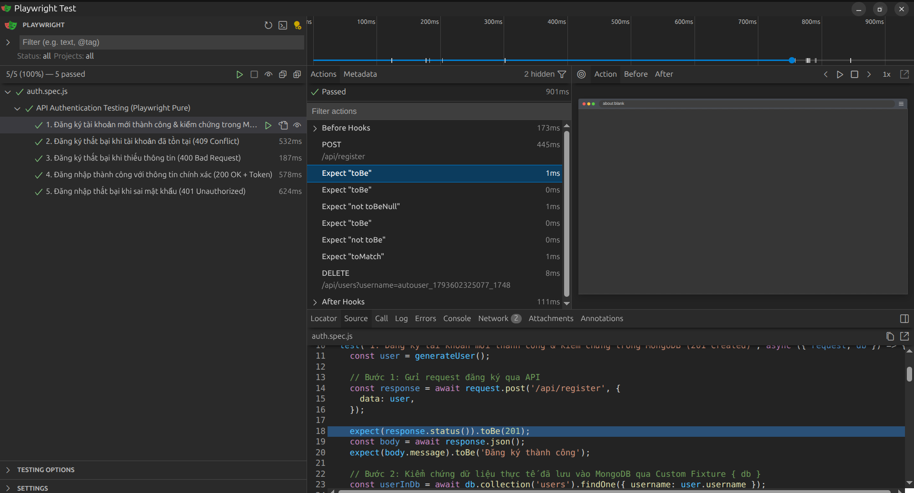

# Automation Test API
### Từ Playwright Thuần Đến Playwright BDD
**Dành cho Team Dev & Tester**

---

## 🎯 Mục Tiêu Buổi Training

1. **Hiểu rõ lý do** chọn Playwright cho API Automation thay vì Postman.
2. **Thực chiến Playwright Thuần**: Cấu trúc test, assertion, parallel testing & test isolation.
3. **Nâng cấp lên Playwright BDD**: Thu hẹp khoảng cách giữa BA/Tester và Developer bằng Gherkin.
4. **Tránh các Anti-Patterns**: Race condition dữ liệu, quản lý state qua Fixtures.
5. **Hạ tầng & Báo cáo**: Tự động bật mock server và xem báo cáo tương tác trực quan.

---

## ⚡ Thách Thức Khi Dùng Postman Cho Automation Test

- **Quản lý Git khó khăn**:
  - File collection JSON xuất ra rất dễ bị xung đột (conflict) khi nhiều người cùng làm việc.
- **Khó viết logic phức tạp**:
  - Script trong Postman khó tái sử dụng thư viện ngoài, helper methods hay dynamic mocking.
- **Tích hợp CI/CD hạn chế**:
  - Chạy automation định kỳ trong pipeline cồng kềnh, chi phí bản quyền Postman tăng cao.
- **Lệch pha giữa Dev & Tester**:
  - Test case viết trong Excel/Jira một đằng, kịch bản Postman một nẻo, thiếu ngôn ngữ chung về hành vi nghiệp vụ.

---

## 🚀 Tại Sao Lại Là Playwright Cho API?

- 🏎️ **Cực kỳ nhẹ & nhanh**: Không cần bật Browser engine, dùng trực tiếp `request` context.
- 🔄 **Chung một hệ sinh thái**: Cùng 1 runner, 1 cú pháp nếu sau này team mở rộng sang UI / E2E test.
- ⚙️ **Tính năng `webServer`**: Tự động bật Backend/Mock service trước khi test chạy.
- 📊 **Báo cáo đỉnh cao**: HTML Report, Tracing, UI Mode soi chi tiết Network, Headers, Payload.
- 🧵 **Đa luồng an toàn**: Tích hợp sẵn cơ chế parallel workers tối ưu tốc độ.

---

## 🏗️ Kiến Trúc Demo Trong Khóa Học

```text
automation-test-training/
├── src/main.go               # Backend Golang + MongoDB (Register & Login API)
└── automation-test/
    ├── playwright/           # Code-First: Test script viết bằng JS thuần
    └── playwright-bdd/       # Behavior-First: Kịch bản Gherkin + Steps
```

- **Backend**: Golang `net/http` + MongoDB (mã hóa bcrypt).
- **Endpoints**:
  - `POST /api/register` (201 Created, 409 Conflict, 400 Bad Request)
  - `POST /api/login` (200 OK + Token, 401 Unauthorized)
  - `DELETE /api/users` (Hỗ trợ clean-up dữ liệu test)

---

## 📐 Cấu Trúc Một File Test API Chuẩn

```javascript
import { test, expect } from '@playwright/test';

test.describe('Nhóm API Authentication', () => {
  // 1. Hooks: Vòng đời chuẩn bị & dọn dẹp
  test.beforeEach(async ({ request }) => { /* Setup */ });
  test.afterEach(async ({ request }) => { /* Teardown */ });

  // 2. Test Case & Fixture { request }
  test('Tên kịch bản kiểm thử', async ({ request }) => {
    // 3. Gọi HTTP Request (POST, GET, ...)
    const res = await request.post('/api/...', { data });

    // 4. Assertions: Kiểm chứng kết quả
    expect(res.status()).toBe(200);
    expect(await res.json()).toHaveProperty('token');
  });
});
```

- **`test.describe`**: Gom nhóm các test case có cùng tính năng/ngữ cảnh nghiệp vụ.
- **`beforeEach / afterEach`**: Hooks tự động chuẩn bị và xóa sạch dữ liệu test.
- **`{ request }` Fixture**: API Client độc lập do Playwright cung cấp, không cần mở Browser.
- **`expect(...)`**: Bộ matcher mạnh mẽ kiểm tra HTTP Status, Response Body, Headers.

---

## Playwright thuần

```javascript
import { test, expect } from '../fixtures/test.js';

test('1. Đăng ký tài khoản & kiểm chứng MongoDB (201 Created)', async ({ request, db }) => {
  const user = generateUser();

  // 1. Gọi API đăng ký
  const response = await request.post('/api/register', { data: user });
  expect(response.status()).toBe(201);
  const body = await response.json();
  expect(body.message).toBe('Đăng ký thành công');

  // 2. Query trực tiếp MongoDB qua Custom Fixture { db }
  const userInDb = await db.collection('users').findOne({ username: user.username });
  expect(userInDb).not.toBeNull();
  expect(userInDb.password).not.toBe(user.password); // Mật khẩu không phải plain-text
  expect(userInDb.password).toMatch(/^\$2[aby]\$/);  // Mật khẩu đã hash Bcrypt

  // 3. Dọn dẹp sau test
  await request.delete(`/api/users?username=${user.username}`);
});
```

---

## Hướng dẫn chạy Test: CLI & UI Mode

### 1. Chạy Dòng Lệnh (CLI):
Phù hợp chạy tự động, tích hợp CI/CD pipeline:
```bash
npm test
# hoặc dùng npx:
npx playwright test
```

### 2. Chạy Giao Diện Tương Tác (UI Mode):
Xem timeline, soi request/response, time-travel:
```bash
npm run test:ui
# hoặc dùng npx:
npx playwright test --ui
```


*(Giao diện Playwright UI Mode: Soi chi tiết Timeline, Network Headers, Body & Dừng breakpoint code)*

---

## Fixture là gì?

### Định nghĩa:
Trong ví dụ vừa rồi, `{ request, db }` chính là các **Fixtures** &mdash; tài nguyên được Playwright **chuẩn bị sẵn trước khi test chạy** và **tự động dọn dẹp sau khi test kết thúc**.

- **Cơ chế**: Kỹ thuật *Dependency Injection* (tiêm phụ thuộc). Playwright tự động cấp service vào test case.
- **1. Built-in Fixture (`{ request }`)**:
  - Có sẵn trong Playwright, gọi HTTP không cần Browser.
  - Import mặc định: `import { test, expect } from '@playwright/test';`
- **2. Custom Fixture (`{ db }`)**:
  - Do ta tự tạo bằng `test.extend()` để kết nối MongoDB.
  - **Quy tắc quan trọng (như thấy ở Slide 7)**: Bắt buộc import từ file custom:  
    `import { test, expect } from '../fixtures/test.js';` *(để dùng được `{ db }`)*.

---

## Custom Fixture `{ db }`

```javascript
// fixtures/test.js
import { test as base } from '@playwright/test';
import { MongoClient } from 'mongodb';

export const test = base.extend({
  // Custom Fixture: Quản lý vòng đời kết nối MongoDB
  db: async ({}, use) => {
    // 1. SETUP: Mở kết nối trước khi test chạy
    const client = new MongoClient('mongodb://localhost:27017');
    await client.connect();

    // 2. BÀN GIAO: Chuyển database cho test case sử dụng
    await use(client.db('training_db'));

    // 3. TEARDOWN: Tự động đóng kết nối khi test xong (dù Pass hay Fail)
    await client.close();
  },
});

export { expect } from '@playwright/test';
```

---

## 🛡️ Best Practice 1: Test Isolation Khi Chạy Song Song

### Vấn đề:
Khi chạy 5 tests với `workers: 4`, nếu tất cả dùng chung username `"test_user"`:
👉 **Race Condition**: Test A xóa user trong khi Test B đang kiểm tra đăng nhập ➔ **FLAKY TEST!**

### Giải pháp:
```javascript
// Sinh username động theo timestamp
const generateUser = () => ({
  username: `user_${Date.now()}_${Math.floor(Math.random() * 10000)}`,
  password: 'password123',
});
```
✅ Mỗi worker sở hữu tập dữ liệu độc lập hoàn toàn.

---

## 🤖 Best Practice 2: Tự Động Bật Server với `webServer`

Đừng bắt tester hay CI/CD phải nhớ gõ `go run ./src` ở terminal khác!

Cấu hình trong `playwright.config.js`:
```javascript
export default defineConfig({
  use: {
    baseURL: 'http://localhost:3000',
  },
  webServer: {
    command: 'cd ../.. && go run ./src',
    url: 'http://localhost:3000/health',
    reuseExistingServer: !process.env.CI,
    timeout: 10000,
  },
});
```
Playwright tự động ping `/health`, nếu chưa có sẽ tự start server!

---

## 🤝 Phần 2: Nâng Cấp Lên Playwright BDD

### Kịch bản Gherkin mẫu:
```gherkin
Feature: Xác thực người dùng (Authentication API)

  Scenario: 1. Đăng ký tài khoản mới thành công
    When người dùng gửi yêu cầu đăng ký với tài khoản "user1" và mật khẩu "pass123"
    Then mã phản hồi HTTP phải là 201
    And thông báo trả về phải là "Đăng ký thành công"

  Scenario: 2. Đăng ký thất bại khi tài khoản đã tồn tại
    Given có một tài khoản "user2" với mật khẩu "pass123" đã tồn tại
    When người dùng gửi yêu cầu đăng ký với tài khoản "user2" và mật khẩu "pass123"
    Then mã phản hồi HTTP phải là 409
    And thông báo lỗi phải là "Tài khoản đã tồn tại"
```

### Thuật ngữ cốt lõi (Gherkin Syntax):
- **`Feature`**: Tên tính năng hoặc nghiệp vụ lớn của hệ thống cần kiểm thử.
- **`Scenario`**: Một kịch bản kiểm thử hành vi cụ thể (tương đương 1 test case).
- **`Given`**: **Tiền điều kiện**, thiết lập trạng thái ban đầu của hệ thống (Context / Precondition).
- **`When`**: **Hành động** hoặc sự kiện kích hoạt từ phía người dùng / client (Action / Trigger).
- **`Then`**: **Kết quả kỳ vọng** hoặc phản hồi quan sát được để kiểm chứng (Outcome / Assertion).
- **`And`**: Liên từ nối thêm các bước tiền điều kiện, hành động hoặc xác minh bổ sung.

---

## ⚙️ Cơ Chế Hoạt Động Của Playwright BDD

### Sơ đồ luồng biên dịch & thực thi:
```text
✍️ File .feature (Gherkin)      ➔ [QA/Tester tự viết kịch bản]
              +
✍️ File .steps.js (Logic code)  ➔ [Dev/Tester tự viết code mapping]
              │
              ▼  Lệnh: npx bddgen (Biên dịch)
🤖 .features-gen/*.spec.js       ➔ [MÁY TỰ SINH 100% - Không sửa tay]
              │
              ▼  Lệnh: npx playwright test
🚀 Runner Playwright Native Thực Thi Siêu Tốc!
```
> 💡 *Nếu thiếu step, `npx bddgen` sẽ in sẵn khung code mẫu (snippets) ra terminal để copy!*

### Bản chất & Vai trò của 2 tệp:
- **📄 File `.feature` (Nghiệp vụ)**:
  - **Bản chất**: Kịch bản kiểm thử viết bằng ngôn ngữ tự nhiên (Given, When, Then).
  - **Vai trò**: Là tài liệu để QA, BA, Dev cùng hiểu và thống nhất nghiệp vụ trước khi code.
- **💻 File `.steps.js` (Kỹ thuật)**:
  - **Bản chất**: Code JS/TS hiện thực hóa từng câu chữ trong file `.feature`.
  - **Vai trò**: Thực thi logic test (gọi API HTTP, query DB MongoDB, assert `expect`). Do Dev/Tester viết.

---

## 🔗 Cơ Chế Ánh Xạ: `.feature` ➔ `.steps.js`

### 1. Kịch bản trong `auth.feature`:
```gherkin
Scenario: 1. Đăng ký tài khoản thành công
  When người dùng gửi yêu cầu đăng ký với tài khoản "user1" và mật khẩu "pass123"
  Then mã phản hồi HTTP phải là 201
```

### 2. Hàm ánh xạ trong `auth.steps.js`:
```javascript
// "user1" và "pass123" tự động map vào {string} ➔ username & password
When('người dùng gửi yêu cầu đăng ký với tài khoản {string} và mật khẩu {string}', 
  async ({ request, apiContext }, username, password) => {
    apiContext.response = await request.post('/api/register', {
      data: { username, password },
    });
});

// 201 tự động map vào {int} ➔ expectedStatus
Then('mã phản hồi HTTP phải là {int}', async ({ apiContext }, expectedStatus) => {
  expect(apiContext.response.status()).toBe(expectedStatus);
});
```

### 🎯 Nguyên tắc Cucumber Expressions:
- Chuỗi trong ngoặc kép `"..."` ➔ khớp với `{string}` và truyền làm tham số cho hàm.
- Số nguyên ➔ khớp với `{int}`. Số thực ➔ `{float}`.
- Tham số đầu tiên `{ request, apiContext, db }` luôn là **Playwright Fixtures** được tự động tiêm vào!

---

## ♻️ Tác Dụng Tái Sử Dụng: Viết Code 1 Lần, Dùng Mọi Nơi

### 1. Dev code 1 lần duy nhất trong `auth.steps.js`:
```javascript
// 1. Step gửi API đăng ký tổng quát:
When('người dùng gửi yêu cầu đăng ký với tài khoản {string} và mật khẩu {string}', 
  async ({ request, apiContext }, username, password) => {
    apiContext.response = await request.post('/api/register', {
      data: { username, password },
    });
});

// 2. Step kiểm tra HTTP Status tổng quát:
Then('mã phản hồi HTTP phải là {int}', async ({ apiContext }, expectedStatus) => {
  expect(apiContext.response.status()).toBe(expectedStatus);
});
```

### 2. QA thoải mái tái sử dụng ở vô số Scenario trong `.feature`:
```gherkin
# Kịch bản 1: Đăng ký thành công
When người dùng gửi yêu cầu đăng ký với tài khoản "u1" và mật khẩu "123"
Then mã phản hồi HTTP phải là 201

# Kịch bản 2: Tài khoản trùng lặp
When người dùng gửi yêu cầu đăng ký với tài khoản "u2" và mật khẩu "123"
Then mã phản hồi HTTP phải là 409

# Kịch bản 3: Thiếu thông tin
When người dùng gửi yêu cầu đăng ký với tài khoản "" và mật khẩu ""
Then mã phản hồi HTTP phải là 400
```

### 🚀 Lợi ích thực tế cho đội ngũ Dev & QA:
- **QA độc lập 100%:** Khi đã có sẵn bộ Steps chuẩn, QA có thể tự viết thêm hàng chục test case mới mà **không cần nhờ Dev viết thêm dòng code nào**.
- **Bảo trì siêu nhanh (DRY):** Khi API thay đổi cách gọi, Dev chỉ cần sửa đúng **1 nơi duy nhất trong `.steps.js`**, tất cả các Scenario đều tự động cập nhật!

---

## 🎯 `Scenario Outline`: Tái Sử Dụng Cả Kịch Bản

### 1. File `auth.steps.js` (Dùng lại các Step thông thường):
```javascript
// Dev KHÔNG cần viết thêm hàm mới nào cho Scenario Outline!
When('người dùng gửi yêu cầu đăng nhập với tài khoản {string} và mật khẩu {string}', 
  async ({ request, apiContext }, username, password) => {
    apiContext.response = await request.post('/api/login', {
      data: { username, password },
    });
});

Then('mã phản hồi HTTP phải là {int}', async ({ apiContext }, expectedStatus) => {
  expect(apiContext.response.status()).toBe(expectedStatus);
});

Then('kết quả phải chứa token {string}', async ({ apiContext }, hasToken) => {
  // kiểm tra token...
});
```

### 2. File `auth.feature` (Scenario Outline):
```gherkin
Scenario Outline: 4. Đăng nhập hệ thống (Data-Driven Testing)
  Given có một tài khoản "bdd_user" với mật khẩu "correct_password" đã tồn tại
  When người dùng gửi yêu cầu đăng nhập với tài khoản "bdd_user" và mật khẩu "<password>"
  Then mã phản hồi HTTP phải là <status_code>
  And kết quả phải chứa token "<has_token>"

  Examples:
    | password         | status_code | has_token |
    | correct_password | 200         | true      |
    | wrong_password   | 401         | false     |
    |                  | 400         | false     |
```

### 💡 Điểm mấu chốt:
Dev **không cần viết thêm hàm mới** cho `Scenario Outline`! Playwright BDD tự động đọc từng dòng trong bảng `Examples` để tiêm giá trị vào các tham số `{string}`, `{int}` của các Step đã có sẵn.

---

## ⚠️ Anti-Pattern Nguy Hiểm Trong BDD: Biến Toàn Cục

❌ **SAI (Gây xung đột state khi chạy parallel):**
```javascript
let authToken; // BIẾN DÙNG CHUNG CẢ FILE
When('đăng nhập', async () => { authToken = res.token; });
```

✅ **ĐÚNG (Dùng Playwright Fixtures):**
```javascript
export const test = base.extend({
  apiContext: async ({}, use) => {
    // Mỗi Scenario nhận 1 context độc lập
    await use({ username: '', response: null, token: '' });
  },
});
```

---

## ⚡ Tra Cứu Lệnh `npx`

| Thao tác | Lệnh `npx` |
| :--- | :--- |
| **Chạy toàn bộ test** | `npx playwright test` |
| **Bật UI Mode trực quan** | `npx playwright test --ui` |
| **Lọc 1 test case cụ thể** | `npx playwright test -g "Đăng ký"` |
| **Chạy từng bước (Debug Mode)** | `npx playwright test --debug` |
| **Xem báo cáo HTML chi tiết** | `npx playwright show-report` |
| **BDD: Biên dịch & chạy** | `npx bddgen && npx playwright test` |

---

## ⚖️ Bảng Quyết Định: Khi Nào Chọn Gì?

| Tiêu chí | Playwright Thuần | Playwright BDD |
| :--- | :--- | :--- |
| **Đối tượng tham gia** | Chỉ Dev & Automation Tester | Cả BA, Manual QA, PO & Dev |
| **Bản chất kiểm thử** | Unit API, Integration sâu, kỹ thuật | Luồng nghiệp vụ End-to-End |
| **Chi phí bảo trì** | Thấp hơn (chỉ sửa code test) | Thêm bước mapping `.feature` $\leftrightarrow$ step |
| **Tài liệu & Báo cáo** | Code-based report | Nghiệp vụ rõ ràng, dễ hiểu cho sếp/khách hàng |

---

## 🏁 Tổng Kết & Mini Challenge

### Thử thách nhỏ cho team tại chỗ:
> Viết thêm 1 kịch bản kiểm tra: *"Gửi yêu cầu đăng ký nhưng để trống mật khẩu"* ➔ Kiểm chứng hệ thống phản hồi `400 Bad Request`.
> - **Cặp Dev & Tester phối hợp:**
>   - Tester viết kịch bản trong `.feature`.
>   - Dev kiểm tra ánh xạ trong `.steps.js` hoặc chạy `npx bddgen`.

---

# Q & A
**Cảm ơn mọi người đã tham gia buổi chia sẻ!**
*(Mã nguồn thực hành có sẵn trong repo)*
